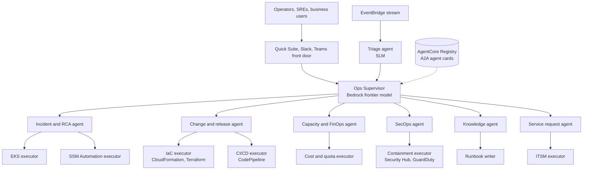

# Agent topology

A hierarchical mesh: supervisor, specialists and narrow executors. Agents are built with the Strands Agents SDK (any framework works on AgentCore Runtime), registered in AgentCore Registry, and authenticated to each other and to tools through AgentCore Identity.

*Figure 2. Executors hold the only IAM roles that can mutate systems.*

| Agent | Responsibility | Default model tier | Key tools | Starting autonomy |
| --- | --- | --- | --- | --- |
| Triage | Classify, dedupe, prioritise every signal | SLM on Inferentia | EventBridge, CMDB lookup | L4 |
| Ops Supervisor | Decompose goals, delegate, arbitrate | Bedrock frontier model | A2A, Registry | L3 |
| Incident and RCA | Correlate, diagnose, remediate | In-house LLM, Bedrock for multimodal | CloudWatch, X-Ray, SSM, EKS MCP | L1 then L3 |
| Change and release | Risk-score changes, canaries, rollback | Bedrock mid-tier model | CodePipeline, CloudFormation, AppConfig | L2 |
| Capacity and FinOps | Rightsizing, Savings Plans, spend anomalies | SLM + Cost Explorer data | Compute Optimizer, Cost Anomaly Detection | L2 |
| SecOps | Finding triage, enrichment, containment | In-house LLM for restricted data | Security Hub, GuardDuty, Detective | L1 |
| Knowledge | Answer questions, keep runbooks current | Bedrock fast model | Knowledge Bases, Kendra | L3 |
| Service request | Fulfil standard requests | SLM + fast model | ServiceNow, IAM Identity Center, Service Catalog | L3 |

## Autonomy levels

| Level | Behaviour |
| --- | --- |
| **L0 Observe** | Shadow mode; AgentCore Policy in log-only mode. |
| **L1 Recommend** | Plan presented; a human executes. |
| **L2 Approve** | Executes after a named approver responds to a Step Functions task token. |
| **L3 Notify** | Executes, then notifies, with a rollback window. |
| **L4 Autonomous** | Executes and closes; reviewed by sampling and evaluations. |

> **Promotion rule.** One level up after 200 executions or 30 days at ≥ 98% plan precision, zero severity-1 side effects, a tested rollback and service-owner sign-off. Any agent-caused severity-1 demotes that action type two levels automatically.

---

[← End to end flow](03-end-to-end-flow.md) · [Index](README.md) · [Model strategy and routing →](05-model-strategy-and-routing.md)
