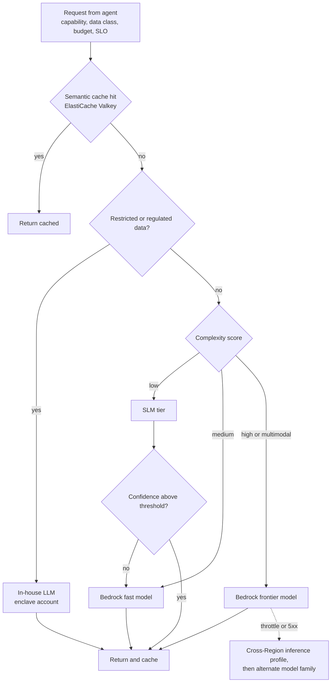

# Model strategy and routing

| Tier | Models | Hosting | Used for |
| --- | --- | --- | --- |
| SLM | Fine-tuned 1–9B open models, distilled classifiers, Bedrock distilled models | EKS with Karpenter on Inferentia2 or G-family GPUs; SageMaker endpoints for steady load | Triage, intent, extraction, log parsing, PII tagging, routing |
| In-house LLM | Fine-tuned open-weight 30–70B models | EKS on Trainium / P5 with vLLM or Neuron; optionally Bedrock Custom Model Import for serverless hosting inside our account boundary | Reasoning over restricted data, RCA narratives, security telemetry |
| Frontier | Amazon Nova family, Anthropic Claude, Meta Llama, Mistral on Bedrock (latest GA versions) | Bedrock on-demand with cross-Region inference profiles; Provisioned Throughput for baseline | Complex planning, long context, multimodal, code generation |

*Figure 3. Cascade routing. Bedrock Intelligent Prompt Routing can serve as the within-family router; our gateway owns cross-tier decisions.*

The gateway also applies Bedrock prompt caching for large stable system prompts, enforces per-agent token budgets, tags every call with cost-allocation tags, and invokes Bedrock Guardrails on both input and output.

---

[← Agent topology and autonomy](04-agent-topology-and-autonomy.md) · [Index](README.md) · [Sequence flows →](06-sequence-flows.md)
