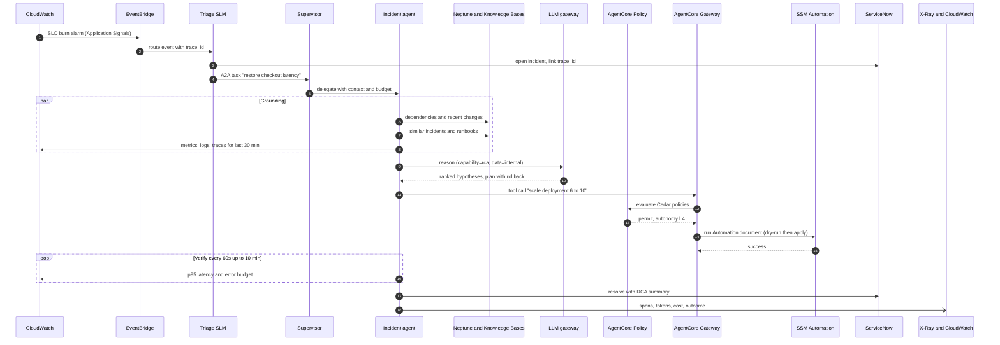
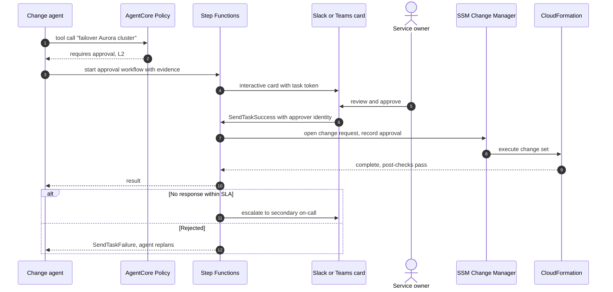
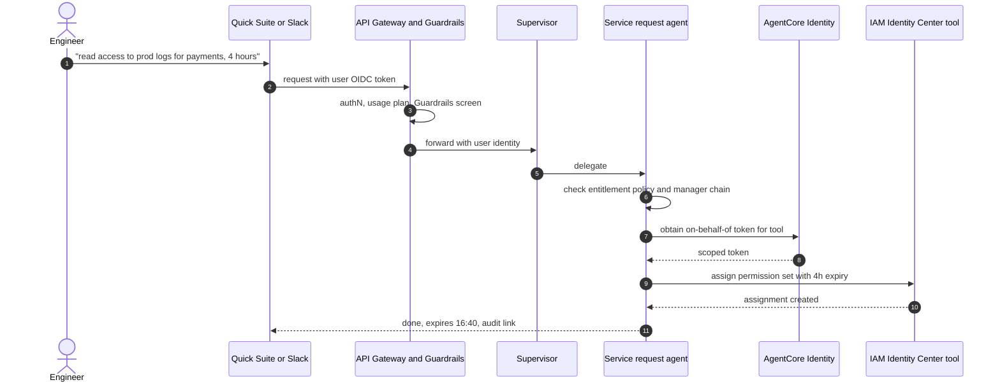

# Sequence flows

## 6.1 Autonomous incident remediation

*Figure 4. AgentCore Policy sits in the Gateway path, so the agent cannot reach a tool without a policy decision.*

## 6.2 Human-in-the-loop approval

*Figure 5. Approvals are durable task tokens, identity-bound and recorded in CloudTrail and Change Manager.*

## 6.3 Conversational access request

*Figure 6. The user's identity, not the agent's, is what the entitlement check evaluates.*

---

[← Model strategy and routing](05-model-strategy-and-routing.md) · [Index](README.md) · [Knowledge and memory →](07-knowledge-and-memory.md)
