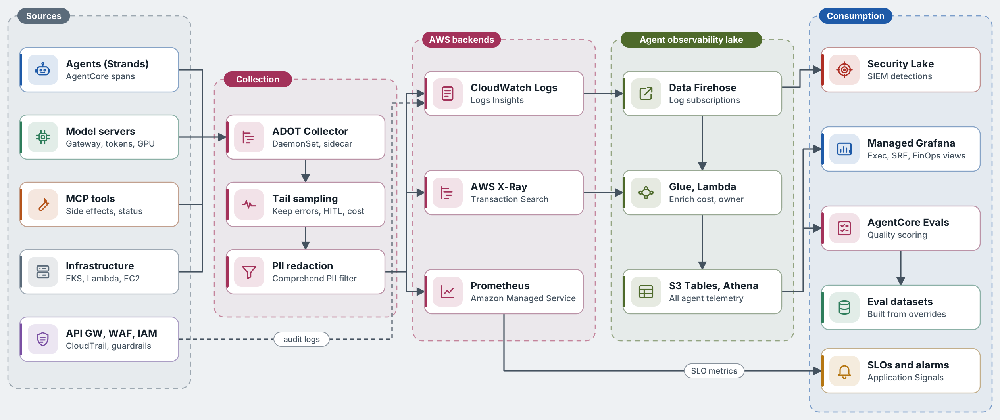

# Observability and telemetry

AgentCore Observability emits OpenTelemetry-compatible traces for agent sessions, model calls and tool invocations into CloudWatch, with a GenAI observability view. ADOT collectors on EKS and Lambda extensions cover the rest, and everything lands in an analytical lake for cost, quality and outcome analysis.

[SVG version](../../diagrams/svg/aws-telemetry-pipeline.svg)

*Figure 7. Telemetry pipeline on AWS. Quality metrics from evaluations are published back into CloudWatch so they can page owners like latency does.*

## Trace anatomy

| Span | Key attributes |
| --- | --- |
| `agent.episode` | agent.id, agent.version, session.id, trigger.type, incident.id, autonomy.level, outcome, cost\_usd |
| `gen_ai.chat` | gen\_ai.request.model (Bedrock model ID or inference profile), input/output tokens, router.tier, cache.hit, guardrail.action |
| `retrieval.query` | knowledge\_base.id, top\_k, latency\_ms, acl\_filtered |
| `policy.decision` | cedar.policy\_id, decision, mode (enforce or log-only), risk.score |
| `hitl.approval` | approver.id, task\_token\_wait\_ms, decision |
| `tool.call` | gateway.target, ssm.execution\_id, idempotency\_key, dry\_run, status |

### Operational

- Episode success and latency
- TTFT and tokens per second per model
- Bedrock throttles and cross-Region spillover
- SQS age and depth
- Neuron core and GPU utilisation

### Quality

- Plan precision
- Groundedness and correctness (AgentCore Evaluations)
- Hallucinated tool or parameter rate
- Human override and rollback rate

### Business

- MTTD and MTTR
- Autonomous resolution rate
- Toil hours removed
- Change failure rate

### Cost and safety

- Cost per episode and per resolved incident
- Guardrail interventions
- Policy denials
- Loop and budget stops

## SLOs

| SLO | Target |
| --- | --- |
| Agent platform availability | 99.9% over 28 days |
| Triage latency | p95 < 5 s |
| P1 time to first diagnosis | p90 < 3 min |
| Autonomous action correctness | ≥ 99% over rolling 500 actions |
| Approval card delivered | p99 < 30 s |

---

[← Knowledge and memory](07-knowledge-and-memory.md) · [Index](README.md) · [Scalability and resilience →](09-scalability-and-resilience.md)
