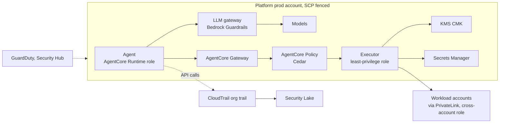

# Security and governance

*Figure 8. Reasoning roles and action roles are distinct. Agents ask; only executors can do, and only within SCP and permission-boundary limits.*

| Threat | Control |
| --- | --- |
| Prompt injection via logs, tickets, documents | Bedrock Guardrails prompt-attack filters on inputs and retrieved content, provenance tags, Cedar policies independent of the model |
| Excessive agency | Per-agent roles, permission boundaries, SCPs denying destructive APIs, Cedar allow-lists per autonomy level |
| Data exfiltration | VPC endpoints with endpoint policies, RCPs and data perimeters (aws:ResourceOrgID, aws:SourceVpce), Network Firewall egress allow-list, Macie on S3 |
| Credential misuse | No long-lived keys; EKS Pod Identity, IAM Roles Anywhere for on-prem, AgentCore Identity token vault, Secrets Manager rotation |
| Supply chain | ECR scanning with Inspector, AWS Signer image signing verified at admission, signed model artefacts, MCP target allow-list |
| Unaccountable decisions | CloudTrail Lake plus agent-lake records of prompt, context, plan, policy decision, approver and side effect |

---

[← Scalability and resilience](09-scalability-and-resilience.md) · [Index](README.md) · [Full system architecture →](11-full-system-architecture.md)
