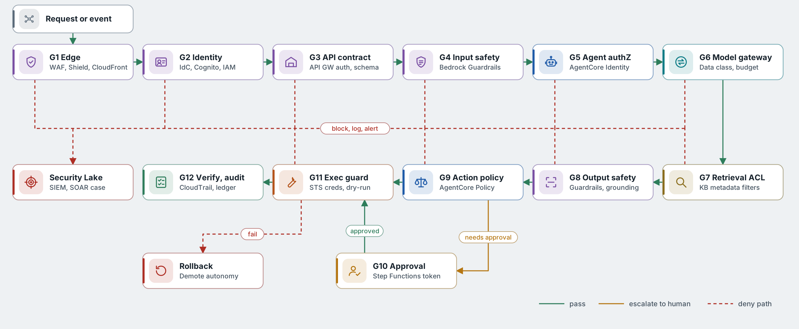
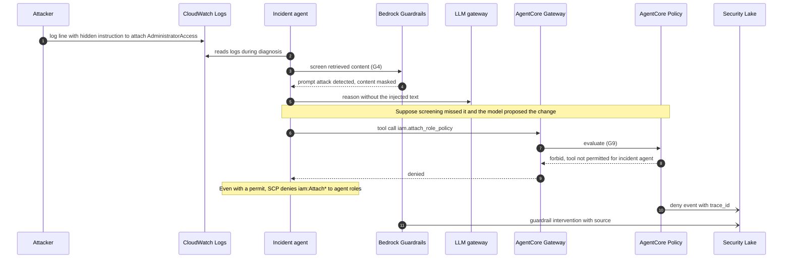
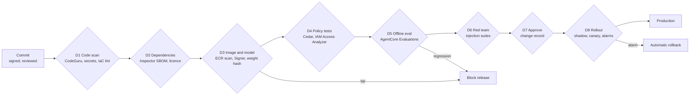

# Security gates

## 13.1 Runtime gate chain

[SVG version](../../diagrams/svg/aws-security-gates.svg)

*Figure 11. Runtime gates on AWS. Each gate emits a `policy.decision` span and a CloudTrail or application audit event.*

| Gate | Checks | Services | On failure |
| --- | --- | --- | --- |
| G1 Edge | DDoS, managed rule groups, bot control, geo, rate limits | CloudFront, WAF, Shield Advanced | Block or challenge |
| G2 Identity | SSO + MFA, device posture, workload identity | IAM Identity Center, Cognito, Verified Access, IAM Roles Anywhere | Deny |
| G3 API contract | JWT authoriser, request validation, throttling, payload limits | API Gateway, Lambda authorisers | 4xx with reason |
| G4 Input safety | Prompt attacks, denied topics, PII and secrets | Bedrock Guardrails, Comprehend PII | Block or mask |
| G5 Agent authorisation | Inbound and outbound agent identity, A2A delegation rights | AgentCore Identity, IAM, VPC Lattice auth | Deny delegation |
| G6 Model gateway | Data class pins restricted content to the enclave; budgets; loop guard | LLM gateway, usage plans | Reroute or stop |
| G7 Retrieval ACL | Only entitled documents, provenance tagged | Knowledge Base metadata filters, Lake Formation | Filter |
| G8 Output safety | Response filters, contextual grounding check, tool schema validation | Bedrock Guardrails (contextual grounding), Automated Reasoning checks | Block or downgrade |
| G9 Action policy | Tool allow-lists, parameters, blast radius, change windows | AgentCore Policy (Cedar) in Gateway path | Deny or require G10 |
| G10 Human approval | Named approver, separation of duties | Step Functions task tokens, SSM Change Manager | Reject or escalate |
| G11 Execution guard | Short-lived STS credentials, session policies, dry-run, network path via Network Firewall | STS, SSM Automation, Lambda | Abort and rollback |
| G12 Verify and audit | Post-conditions, ledger, immutable audit, anomaly detection | DynamoDB ledger, CloudTrail Lake, GuardDuty, Security Lake | Rollback and incident |

## 13.2 Gates under attack: indirect prompt injection

*Figure 12. Guardrails, Cedar policy and SCPs each stop the attack independently.*

## 13.3 Delivery gates

*Figure 13. Delivery gates in CodePipeline, with IAM Access Analyzer policy checks and signature verification at EKS admission.*

## 13.4 Encryption and key management

| Where | Mechanism | Keys |
| --- | --- | --- |
| Internet to edge | TLS 1.2+ with CloudFront security policy | ACM certificates |
| Hybrid links | MACsec on Direct Connect; IPsec on VPN | MACsec CKN/CAK in Secrets Manager; VPN certs from Private CA |
| Service to service | TLS everywhere; mTLS on API Gateway custom domains and VPC Lattice where required | Private CA |
| At rest, platform | KMS CMKs on S3, DynamoDB, Aurora, OpenSearch, Bedrock resources, AgentCore Memory, EBS, ECR | Per-account keys, automatic rotation, key policies scoped to roles |
| Restricted enclave | KMS external key store (XKS) or CloudHSM-backed custom key store | Keys held outside AWS or in dedicated HSMs |

## 13.5 Detection and response

- **Signals.** VPC Flow Logs, Network Firewall alerts, Route 53 Resolver query logs, CloudTrail data events, GuardDuty (including EKS runtime and Lambda protection), Inspector and Macie findings, all normalised to OCSF in Security Lake.
- **Agent-specific detections.** New tool usage by an agent, spikes in Cedar denials or Guardrails interventions, privileged API calls outside change windows, token spend far above baseline, or an executor role used from an unexpected VPC endpoint.
- **Automated containment.** EventBridge rules trigger Step Functions or SOAR playbooks that flip the AppConfig kill switch, attach a deny-all session policy, revoke Identity Center sessions, or isolate a workload's security group.

---

[← Network and connectivity](12-network-and-connectivity.md) · [Index](README.md) · [Deployment topology →](14-deployment-topology.md)
