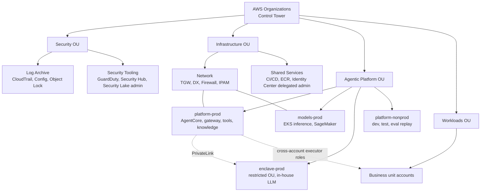

# Account topology

*Figure 14. Multi-account layout. SCPs and RCPs at OU level enforce region restrictions, deny public resources, and block agent roles from IAM and organisation changes.*

---

[← Security gates](13-security-gates.md) · [Index](README.md) · [Agentops lifecycle →](15-agentops-lifecycle.md)
