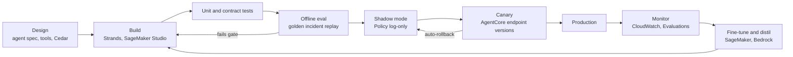

# AgentOps lifecycle

*Figure 15. Release gates: evaluation score ≥ previous version, no safety regressions, cost per episode within 10% of budget.*

---

[← Deployment topology](14-deployment-topology.md) · [Index](README.md) · [Finops →](16-finops.md)
