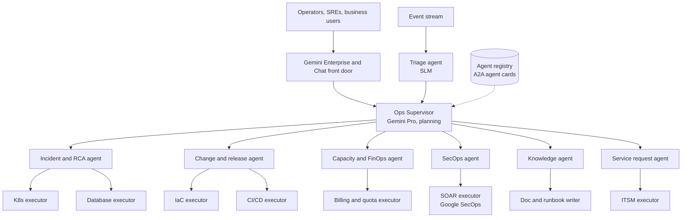

# Agent topology

A hierarchical-mesh model: one supervisor per operating domain boundary, specialist agents beneath it, and narrow executor agents that wrap a single tool family. Agents discover each other through an internal registry that publishes A2A agent cards, so a new specialist can join without redeploying the supervisor.

*Figure 2. Supervisor, specialist and executor tiers. Executors hold the only credentials that can mutate systems.*

| Agent | Responsibility | Default model tier | Key tools | Starting autonomy |
| --- | --- | --- | --- | --- |
| Triage | Classify, dedupe, prioritise, enrich every signal | SLM (fine-tuned) | Pub/Sub, CMDB lookup | L4 autonomous |
| Ops Supervisor | Decompose goals, delegate, arbitrate conflicts, summarise | Gemini Pro | A2A, registry | L3 |
| Incident and RCA | Correlate, diagnose, propose and apply remediation | In-house LLM, Gemini for multimodal | Monitoring, Logging, Trace, K8s MCP | L1 then L3 |
| Change and release | Risk-score changes, run canaries, auto-rollback | Gemini Flash | Cloud Deploy, Infra Manager, Git | L2 |
| Capacity and FinOps | Rightsizing, commitments, anomaly detection on spend | SLM + BigQuery ML | Billing export, Recommender API | L2 |
| SecOps | Alert triage, enrichment, containment playbooks | Gemini in Google SecOps, in-house LLM for restricted data | SecOps SOAR, SCC | L1 |
| Knowledge | Answer questions, keep runbooks current from resolved incidents | Gemini Flash | Vertex AI Search, Drive, Confluence | L3 |
| Service request | Fulfil standard requests (access, environments, resets) | SLM + Flash-Lite | ServiceNow, IAM, Terraform modules | L3 |

## Autonomy levels

Autonomy is set per action type, not per agent. The incident agent may restart a pod autonomously (L4) while needing approval to fail over a database (L2).

| Level | Behaviour |
| --- | --- |
| **L0 Observe** | Agent watches and records what it would have done. Shadow mode only. |
| **L1 Recommend** | Diagnosis and plan presented to a human who executes manually. |
| **L2 Approve** | Agent executes after a named human approves in Chat or ITSM. |
| **L3 Notify** | Agent executes, then notifies; human can roll back within a window. |
| **L4 Autonomous** | Agent executes and closes. Reviewed by sampling and evals only. |

> **Promotion rule.** An action type moves up one level only after at least 200 executions (or 30 days) at the current level with ≥ 98% plan precision, zero severity-1 side effects, a tested rollback, and sign-off from the service owner. Any severity-1 caused by an agent demotes that action type two levels automatically.

---

[← End to end flow](03-end-to-end-flow.md) · [Index](README.md) · [Model strategy and routing →](05-model-strategy-and-routing.md)
