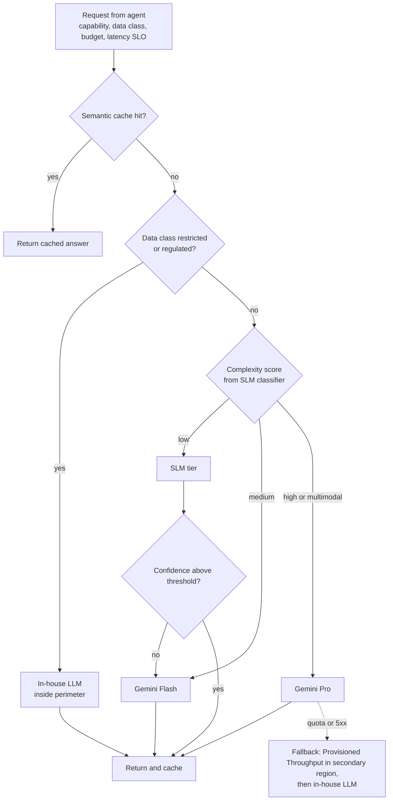

# Model strategy and routing

We run a three-tier model portfolio behind one gateway. Teams request capabilities (`classify`, `reason`, `summarise`, `code`, `vision`), not model names, so we can swap models without touching agents.

| Tier | Models | Hosting | Used for | Why |
| --- | --- | --- | --- | --- |
| SLM | Fine-tuned Gemma-family and other 1–9B open models; distilled classifiers | Cloud Run with L4 GPUs (scale to zero), Vertex AI Endpoints for steady load | Triage, intent, entity extraction, log parsing, PII tagging, routing decisions | Sub-100 ms, pennies per million tokens, can be trained on our own labelled tickets |
| In-house LLM | Fine-tuned open-weight 30–70B models | GKE Autopilot / Standard with H100 or TPU node pools, vLLM, GKE Inference Gateway | Reasoning over restricted data (security logs, customer data, regulated workloads), RCA narratives | Data never leaves our VPC-SC perimeter; predictable cost at high utilisation |
| Frontier | Gemini Pro, Flash and Flash-Lite (latest GA versions); partner models via Model Garden as fallback | Vertex AI, Provisioned Throughput for baseline, pay-as-you-go for burst | Complex planning, long-context analysis, multimodal (dashboards, screenshots, diagrams), code generation | Best reasoning quality, 1M+ token context, grounding with Google Search where appropriate |

## Routing decision

*Figure 3. Router logic. Escalation on low confidence ("cascade") keeps most traffic on the cheapest tier.*

### Gateway responsibilities

- Unified OpenAI-compatible and Vertex-native API for all agents
- Per-agent token budgets and rate limits (Apigee), hard stops on runaway loops
- Semantic cache in Memorystore keyed by embedding plus policy context
- Prompt and response logging with DLP redaction before storage
- Circuit breakers, retries with jitter, regional failover
- Cost attribution labels: agent, use case, business unit

### Model supply chain

- All self-hosted weights scanned, signed and stored in Artifact Registry / Model Registry
- Fine-tuning via Vertex AI tuning (Gemini) and Vertex AI Pipelines (open models, LoRA / QLoRA)
- Every model version carries an evaluation card before it can be routed to
- Shadow traffic: new versions receive mirrored requests and are scored offline before canary

---

[← Agent topology and autonomy](04-agent-topology-and-autonomy.md) · [Index](README.md) · [Sequence flows →](06-sequence-flows.md)
