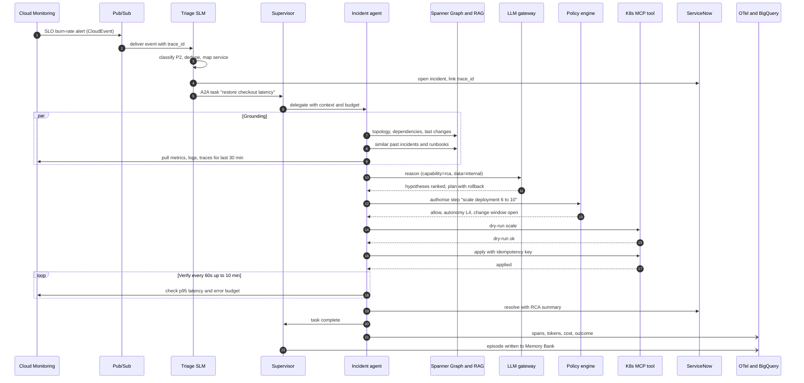
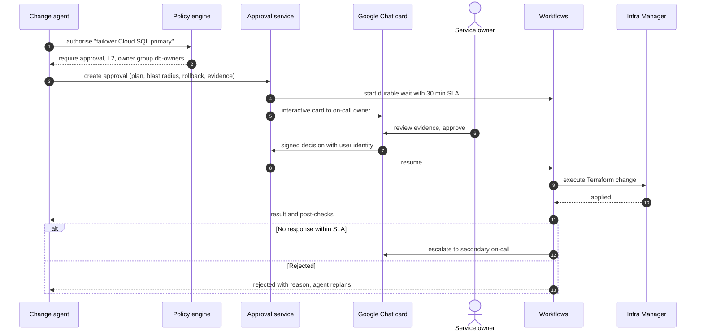
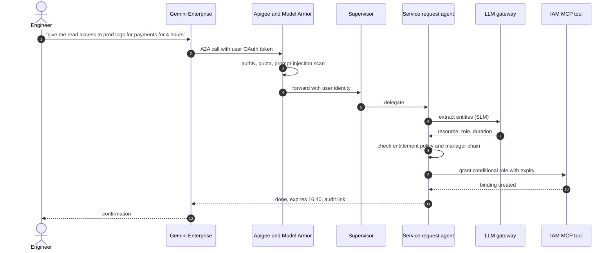

# Sequence flows

## 6.1 Autonomous incident remediation

A latency SLO burn alert on a GKE service, resolved end to end within policy.

*Figure 4. Every arrow is a span in Cloud Trace, joined by the trace\_id created at the alert.*

## 6.2 Human-in-the-loop approval for a high-risk action

*Figure 5. Approvals are durable (Workflows), identity-bound and recorded in Cloud Audit Logs and the agent lake.*

## 6.3 Conversational request through Gemini Enterprise

*Figure 6. The agent acts on behalf of the user; the user's identity, not the agent's, is what IAM Conditions evaluate.*

---

[← Model strategy and routing](05-model-strategy-and-routing.md) · [Index](README.md) · [Knowledge and memory →](07-knowledge-and-memory.md)
