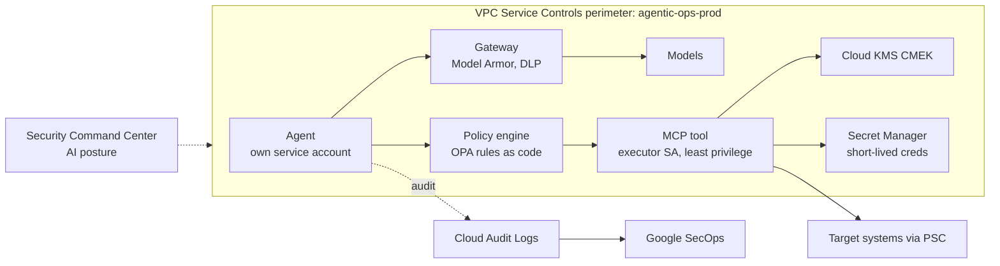

# Security and governance

Agents are a new class of privileged identity. The security model treats every agent as an untrusted-by-default workload that can be tricked, and places controls where a compromised prompt cannot reach them.

*Figure 8. Reasoning identities and action identities are different service accounts. An agent can ask; only an executor can do.*

| Threat | Control |
| --- | --- |
| Prompt injection via logs, tickets or documents | Model Armor on inputs and retrieved content, content provenance tags, tools never accept instructions from data fields, policy engine independent of the LLM |
| Excessive agency | Per-agent service accounts, IAM Conditions, action allow-lists per autonomy level, dry-run and blast-radius limits |
| Data exfiltration | VPC-SC perimeters, Private Service Connect, egress deny by default, DLP on prompts and outputs, restricted data pinned to in-house models |
| Credential misuse | No long-lived keys; Workload Identity and Secret Manager with short TTL; credentials held by executors only |
| Supply-chain compromise of models or tools | Binary Authorization, signed model artefacts, MCP server allow-list, SBOMs, vulnerability scanning in Artifact Registry |
| Unaccountable decisions | Immutable audit of prompt, context, plan, policy decision, approver and side effect; retained per regulatory schedule |

Governance is run by an AI Ops Council (architecture, security, risk, operations) that owns the autonomy promotion process, the model approval list and the responsible-AI review for any new agent. Policies live as code in Git and deploy through the same pipeline as agents.

---

[← Scalability and resilience](09-scalability-and-resilience.md) · [Index](README.md) · [Full system architecture →](11-full-system-architecture.md)
