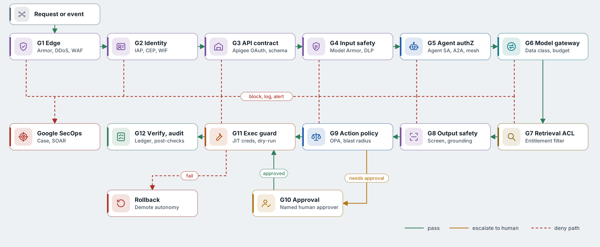
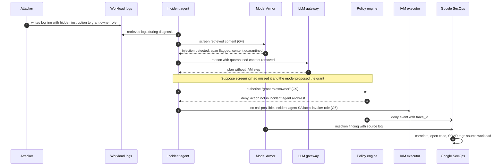
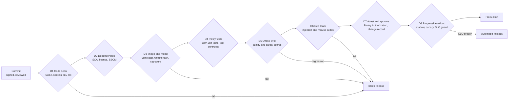

# Security gates

Security is enforced as a chain of gates that every request and every release must pass. Each gate is deterministic, independently owned, logged, and fails closed. No single gate relies on the LLM behaving correctly.

## 13.1 Runtime gate chain

[SVG version](../../diagrams/svg/gcp-security-gates.svg)

*Figure 11. Runtime gates in request order. Each gate emits a `policy.decision` span and an audit log entry.*

| Gate | Checks | Services | Owner | On failure |
| --- | --- | --- | --- | --- |
| G1 Edge | Volumetric and L7 DDoS, OWASP rules, bot scores, geo, per-client rate limits | Cloud Armor Enterprise, Adaptive Protection, global ALB | Network security | 403 or throttle; signature to SecOps |
| G2 Identity and context | User SSO + MFA, device posture, access level; workload federation for machines | IAP, Chrome Enterprise Premium, Cloud Identity, Workload Identity Federation | Identity team | Deny; risky sign-in alert |
| G3 API contract | OAuth scopes, JWT validation, JSON schema, payload size, spike arrest, token quotas | Apigee X | API platform | 4xx with reason code |
| G4 Input safety | Prompt injection and jailbreak detection, malicious URLs, PII and secrets detection and redaction | Model Armor, Sensitive Data Protection | AI security | Block or redact; quarantine sample |
| G5 Agent authorisation | Is this caller allowed to invoke this agent; is this agent allowed to delegate to that agent over A2A; mesh authz | IAM, Agent Engine identity, Cloud Service Mesh | Platform team | Deny delegation |
| G6 Model gateway | Data classification pins restricted content to in-house models; per-agent budget; loop guard | LLM gateway, Apigee quotas | Platform team | Reroute or stop episode |
| G7 Retrieval ACL | Only documents and records the on-behalf-of user may read; provenance tag on each chunk | Vertex AI Search ACLs, RAG metadata filters, Spanner row policies | Data governance | Filter silently; log counts |
| G8 Output safety | Response screening, sensitive data leak check, groundedness threshold, tool-call schema validation | Model Armor, DLP, Gen AI evaluation checks in-line | AI security | Block, regenerate, or downgrade to recommend-only |
| G9 Action policy | Action allow-list per autonomy level, blast radius, change freeze windows, target criticality, rate of change | OPA on Cloud Run, policy bundles from Git | Service owners + AI Ops Council | Deny or require G10 |
| G10 Human approval | Named approver in owning group, evidence reviewed, separation of duties (requester cannot approve) | HITL service, Workflows, Google Chat cards | Service owners | Reject, escalate, or time out |
| G11 Execution guard | Just-in-time scoped credentials, dry-run, idempotency, network reachability through NGFW, rate limits on target | Executor SAs, Secret Manager, PAM, Cloud NGFW, Cloud Tasks | Platform team | Abort, rollback, demote action type |
| G12 Verify and audit | Post-conditions met, side-effect ledger written, immutable audit record, anomaly detection | Spanner ledger, Cloud Audit Logs, SecOps detections | Security operations | Auto-rollback and incident |

## 13.2 Gates under attack: indirect prompt injection

The most likely attack on an ops agent is an instruction hidden in data it reads, such as a crafted log line or ticket comment. The flow below shows how several independent gates stop it even if the model is fooled.

*Figure 12. Defence in depth: content screening, policy allow-lists and IAM each stop the attack on their own.*

## 13.3 Delivery gates

Every agent, prompt, tool, policy bundle and model version reaches production only through the pipeline below. Binary Authorization on GKE and Cloud Run rejects any image without the full set of attestations.

*Figure 13. Delivery gates, implemented with Cloud Build, Artifact Analysis, Vertex AI Pipelines, Binary Authorization and Cloud Deploy.*

## 13.4 Encryption and key management

| Where | Mechanism | Keys |
| --- | --- | --- |
| Internet to edge | TLS 1.2+ (1.3 preferred), HSTS, SSL policy restricting ciphers | Certificate Manager managed certificates |
| Hybrid links | MACsec on Interconnect; IPsec on HA VPN; optional HA VPN over Interconnect | MACsec CAK keys rotated quarterly; IKE certificates from Certificate Authority Service |
| Service to service | mTLS through Cloud Service Mesh | Mesh CA, 24-hour workload certificates |
| Data at rest, platform | CMEK on BigQuery, Spanner, AlloyDB, GCS, Vertex AI resources, Pub/Sub, Artifact Registry | Cloud KMS with Cloud HSM, per-perimeter key rings, automatic rotation |
| Restricted enclave | CMEK with externally held keys; Confidential GKE nodes (confidential GPUs where supported) for data in use | Cloud EKM with Key Access Justifications |
| Provider access | Access Transparency logs and Access Approval for Google personnel access | Approval by security leads |

## 13.5 Detection and response for the agent platform

- **Network telemetry.** VPC Flow Logs on all subnets, Cloud NGFW IPS threat logs, Packet Mirroring into Cloud IDS for the restricted enclave, Interconnect and VPN tunnel metrics in Cloud Monitoring.
- **Posture.** Security Command Center Enterprise with AI protection for model, agent and dataset inventory, misconfiguration findings, and toxic-combination analysis.
- **Agent-specific detections in Google SecOps.** An agent calling a tool it has never used, a spike in policy denials, privileged actions outside change windows, token spend far above baseline, repeated Model Armor findings from one data source, or an executor credential used from an unexpected network.
- **Automated containment.** SOAR playbooks can flip an agent's kill switch, disable its service account, revoke PAM grants, isolate a workload with a deny tag, or pin the router to recommend-only mode, all in under a minute.
- **Evidence.** Audit and agent-lake logs are written to locked log buckets with retention policies, giving tamper-evident records for investigations and regulators.

---

[← Network and connectivity](12-network-and-connectivity.md) · [Index](README.md) · [Deployment topology →](14-deployment-topology.md)
