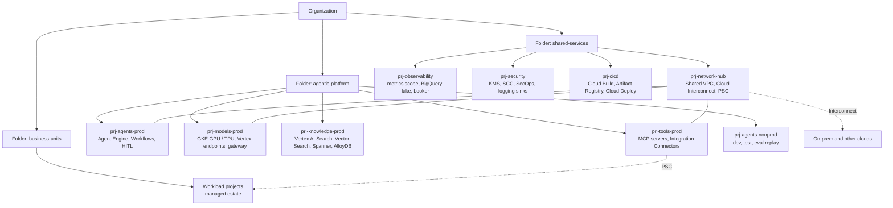

# Deployment topology

*Figure 14. Landing-zone layout. Each platform project sits in its own VPC-SC perimeter with bridge rules only where needed.*

---

[← Security gates](13-security-gates.md) · [Index](README.md) · [Agentops lifecycle →](15-agentops-lifecycle.md)
