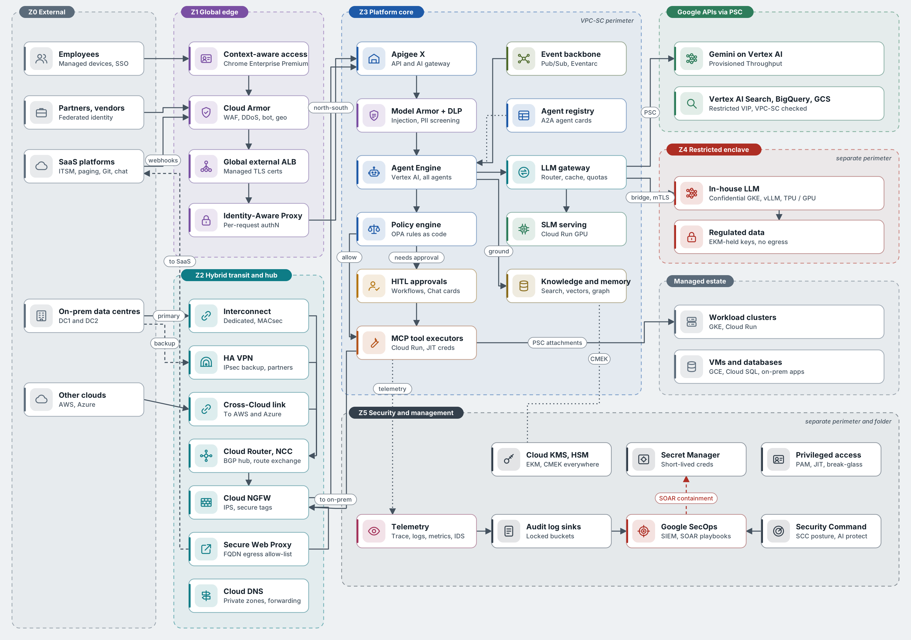
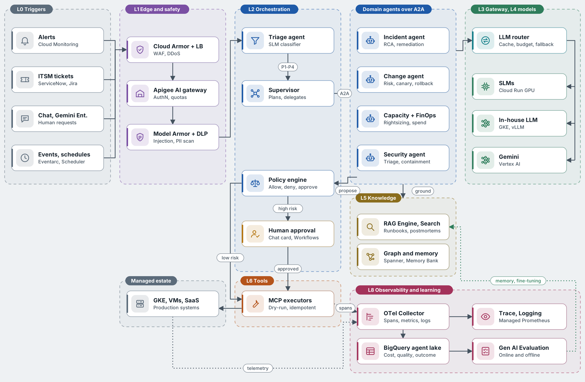
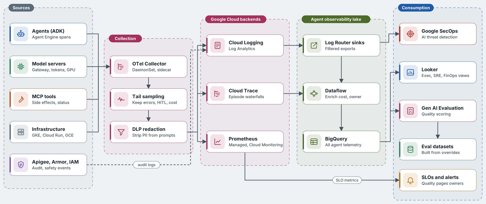
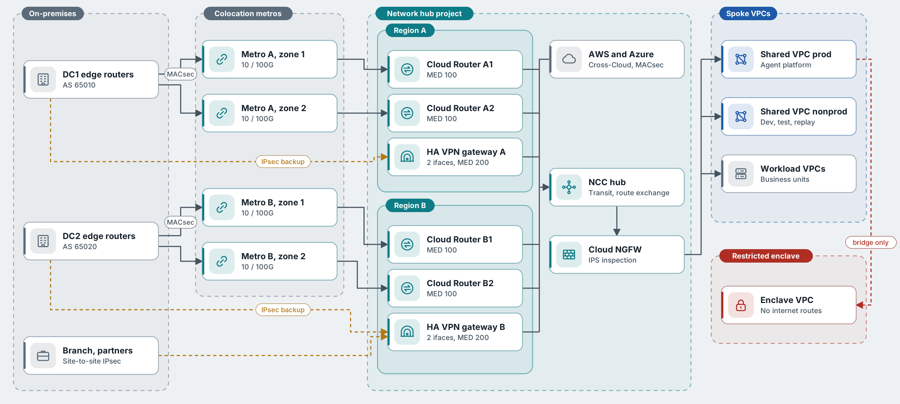

# Agentic Ops on Google Cloud: A Reference Architecture for the Enterprise

*How I would design an operations platform where AI agents diagnose, act and learn, with humans setting the rules rather than doing the toil.*

*Disclosure: I used an AI assistant to help structure and draft parts of this article. The architecture, opinions and final edits are my own.*

> Published on Medium: `<add Medium link after publishing>`

Every enterprise I talk to has the same operations story. Alerts fire faster than people can read them. Tickets bounce between queues. The engineer who knows how to fix the payments database is on holiday. And the AI pilot that was meant to help is a chatbot that summarises runbooks but cannot touch anything.

I think operations is the first enterprise domain that is genuinely ready for agents. The signals are machine-generated, the actions are already scripted, and success is measurable in minutes of downtime. What is missing is not model capability. It is architecture: identity, policy, observability and network design that let an agent act in production without becoming the most dangerous privileged user in the company.

This article is the reference architecture I have been developing for that problem on Google Cloud. It covers the layers, the agent topology, how models are chosen, how every decision is traced, and the security gates that keep an autonomous system honest. It is opinionated, and I would rather you argue with it than skim it.

## Why chatbots are not enough

Google's SRE book defines toil as manual, repetitive, automatable work that scales linearly with the service. Most operations teams still spend a large share of their week on exactly that: triaging alerts, correlating dashboards, running the same runbook for the hundredth time.

The first wave of generative AI in operations mostly added a conversational layer on top. A chatbot can explain an error or find a runbook. It cannot restart the pod, roll back the release or open the change request, so the human still does the work.

An agentic platform closes that loop. Agents observe signals, reason over enterprise context, plan, act through governed tools, verify the result and learn from the outcome. That shift from answering to acting changes the architecture completely. The hard questions stop being about prompts and start being about identity, authorisation, blast radius, audit and cost.

## Six principles I design by

Before any service names, these are the rules every later decision answers to.

1. **Agents are workloads, not features.** Every agent has an identity, a versioned spec, an SLO, a budget, an owner and a kill switch. It is deployed, observed and retired like any production service.
2. **Right model for the job.** Small language models handle high-volume, narrow tasks. In-house LLMs handle restricted data. Gemini handles deep reasoning and multimodal work. A central gateway decides, not individual teams.
3. **Autonomy is earned.** Each action type starts in shadow mode and graduates based on measured precision, blast radius and reversibility.
4. **Everything is a trace.** Every perception, model call, retrieval, tool call and approval is an OpenTelemetry span joined by one trace ID.
5. **Policy lives outside the prompt.** Guardrails are enforced by deterministic services at the gateway and tool boundary, never only by instructions to the model.
6. **Open protocols at every seam.** MCP for tools, A2A between agents, OpenTelemetry for telemetry, OCI and Terraform for delivery. This keeps the design portable, and I have already mapped it to AWS with the same layers.

Principle five is the one I see broken most often. If your only defence against an agent deleting production is a sentence in its system prompt, you do not have a defence.

## The eleven layers

I split the platform into eleven layers, each with one responsibility. The value is less in the exact count than in forcing every component to declare which job it does.

| Layer | Responsibility | Main Google Cloud services |
| --- | --- | --- |
| L0 Channels and triggers | How work reaches agents | Gemini Enterprise, Google Chat, Cloud Monitoring alerts, Eventarc, Pub/Sub |
| L1 Edge, identity, safety | Authenticate, rate-limit, sanitise | Cloud Armor, Apigee, IAP, Model Armor, Sensitive Data Protection |
| L2 Agent orchestration | Supervisor, domain agents, durable execution | Vertex AI Agent Engine, ADK, A2A, Workflows |
| L3 Model gateway | Routing, caching, quotas, fallback | Custom LLM gateway on GKE, Memorystore, GKE Inference Gateway |
| L4 Model serving | Frontier and in-house models | Gemini on Vertex AI, Model Garden, vLLM on GKE, Cloud Run GPU |
| L5 Knowledge and memory | Grounding and long-term memory | Vertex AI Search, RAG Engine, Vector Search, Spanner Graph, Memory Bank |
| L6 Tools and actions | The only way agents change anything | MCP servers on Cloud Run, Integration Connectors, Infrastructure Manager |
| L7 Data and events | Signals in, facts out | Pub/Sub, Dataflow, BigQuery |
| L8 Observability | Traces, metrics, logs, quality, cost | OpenTelemetry, Cloud Trace, Cloud Logging, Managed Prometheus, Gen AI Evaluation |
| L9 Security and governance | Boundaries, keys, posture, audit | VPC Service Controls, Cloud KMS, Security Command Center, Google SecOps |
| L10 Platform and MLOps | Build, tune, evaluate, ship | Vertex AI Pipelines, Model Registry, Cloud Build, Cloud Deploy |

Two layers deserve a comment. L3, the model gateway, is the one most teams skip, and it is the one that later saves them: it is where cost attribution, data-class routing, caching and fallback live. L6 is deliberately narrow. Agents never hold credentials that mutate systems; only executor tools behind MCP do, so an agent can ask but only an executor can act.

## How a signal becomes an outcome

Every agent, whatever its domain, runs the same six-stage loop. It is essentially the reason-and-act pattern from the ReAct paper, hardened for production. Uniformity is the point: it lets one policy engine, one telemetry schema and one evaluation harness cover every agent.

1. **Perceive.** Normalise the alert, ticket or chat message into a CloudEvent, dedupe it and correlate it with open incidents.
2. **Ground.** Pull topology from Spanner Graph, recent changes, runbooks, similar past incidents from memory, and the last 30 minutes of metrics.
3. **Reason and plan.** Rank hypotheses and produce a typed plan of tool calls, each with an expected effect and a rollback step.
4. **Authorise.** Check each step against policy: blast radius, change window, data class and autonomy level. Route to a human if required.
5. **Act.** Execute through MCP tools with idempotency keys, dry-run first where possible, then verify post-conditions.
6. **Learn.** Close the ticket, write episodic memory, capture feedback and add the case to evaluation datasets.

A concrete example: a latency SLO burn alert on a checkout service. The triage SLM classifies it as P2 and opens the incident. The supervisor delegates to the incident agent over A2A. The agent sees a deploy 40 minutes earlier and saturated pods, proposes scaling from 6 to 10 replicas, policy allows it at full autonomy, the tool dry-runs then applies, and the agent watches p95 latency recover before resolving the ticket with an RCA summary. Every one of those steps is a span in Cloud Trace under the trace ID created at the alert. The full sequence diagram is in [Sequence flows](../architecture/gcp/06-sequence-flows.md).

## Earned autonomy

The single most useful idea in this design is that autonomy is set per action type, not per agent. The same incident agent may restart a pod on its own while still needing a human to approve a database failover. The levels borrow the spirit of the SAE driving-automation scale and recent research on levels of autonomy for AI agents.

| Level | Name | What the agent does |
| --- | --- | --- |
| L0 | Observe | Records what it would have done. Shadow mode only. |
| L1 | Recommend | Presents diagnosis and plan; a human executes. |
| L2 | Approve | Executes after a named human approves in Chat or the ITSM tool. |
| L3 | Notify | Executes, then notifies; a human can roll back within a window. |
| L4 | Autonomous | Executes and closes; reviewed by sampling and evaluations. |

My promotion rule is deliberately boring. An action type moves up one level only after at least 200 executions or 30 days at its current level, with 98% or better plan precision, zero severity-1 side effects, a tested rollback and the service owner's sign-off. Any severity-1 caused by an agent demotes that action type two levels automatically.

This turns the conversation with risk and audit teams from "do you trust AI?" into "here is the evidence for this one action". In my experience that is the conversation that actually gets approved.

## A three-tier model portfolio

I do not believe in one model for everything. Operations traffic is overwhelmingly simple and high-volume, with a thin tail of genuinely hard reasoning, so the portfolio is tiered.

| Tier | Models and hosting | Used for |
| --- | --- | --- |
| SLM | Fine-tuned 1–9B open models on Cloud Run GPU or Vertex AI endpoints | Triage, intent, extraction, log parsing, PII tagging, routing |
| In-house LLM | Fine-tuned 30–70B open-weight models on GKE with vLLM, TPU or GPU | Reasoning over restricted data that must stay inside our perimeter |
| Frontier | Gemini Pro, Flash and Flash-Lite on Vertex AI | Complex planning, long context, multimodal, code generation |

Agents ask the gateway for a capability such as classify, reason or summarise, never for a model name. The router checks a semantic cache, pins restricted data to the in-house tier, scores complexity with a small classifier, and sends low-complexity work to the SLM first. If the SLM's confidence is low, the request cascades up to Gemini Flash. This cascade pattern, studied in work such as FrugalGPT, is how you keep most tokens on the cheapest tier without sacrificing quality.

My working target is 70% or more of tokens served by SLMs or cache. The gateway also owns per-agent token budgets, regional failover through Provisioned Throughput, and the cost labels that make FinOps possible later.

## Everything is a trace

Observing an agentic system means watching three things at once: the infrastructure, the agents' behaviour, and the quality of their decisions. I instrument all three with OpenTelemetry using its generative AI semantic conventions, and land everything in BigQuery as an "agent observability lake".

Each agent episode is a root span. Beneath it sit spans for the plan, every model call (model, tokens, time to first token, cache hit, router tier), every retrieval, every policy decision, every human approval and every tool call with its idempotency key. Tail sampling keeps 100% of errors, approvals and expensive episodes, and a DLP processor strips PII before anything is stored.

I track four families of signals:

- **Operational:** episode success and latency, tool error rate, queue age, GPU and KV-cache utilisation.
- **Quality:** plan precision, groundedness, hallucinated tool calls, human override and rollback rate.
- **Business:** MTTD, MTTR, autonomous resolution rate, toil hours removed.
- **Cost and safety:** cost per resolved incident, cache hit rate, Model Armor blocks, policy denials.

The part most teams miss is making quality a paging signal. Offline, every agent version replays a golden set of past incidents and is scored by the Gen AI Evaluation Service. Online, 5–10% of production episodes are scored asynchronously, and every human override becomes a new test case. Those scores are exported to Cloud Monitoring, so a drop in groundedness pages the owning team exactly like a latency regression would.

## Security: zones, network and twelve gates

Agents are a new class of privileged identity, and they can be tricked. I treat every agent as untrusted by default and place controls where a compromised prompt cannot reach them.

**Trust zones.** The estate is split into six zones: external, global edge, hybrid transit and hub, platform core inside a VPC Service Controls perimeter, a restricted enclave for the in-house LLM and regulated data, and a separate security and management zone. Nothing in the platform core has a public IP.

**Network.** Data centres connect over Dedicated Interconnect in Google's 99.99% topology, with MACsec encryption. HA VPN carries the same routes with a worse BGP preference, so it only takes traffic if Interconnect fails. Google APIs are reached through Private Service Connect, egress is denied by default, and SaaS calls leave only through Secure Web Proxy with a per-tool domain allow-list.

**Twelve runtime gates.** Every request passes a chain of deterministic, independently owned gates that fail closed: edge, identity, API contract, input safety, agent authorisation, model gateway, retrieval ACL, output safety, action policy, human approval, execution guard, and verify-and-audit.

The test I use for this design is indirect prompt injection, the attack described by Greshake and colleagues and listed by OWASP as the top LLM risk. Imagine an attacker writes a log line telling the agent to grant themselves an owner role. Model Armor should flag the retrieved content. If it misses, the policy engine denies the action because IAM changes are not in the incident agent's allow-list. If that somehow passes, the agent's service account has no permission to call the IAM executor at all. Three independent controls, none of which depends on the model behaving well.

## Scale, resilience and cost

At enterprise scale the platform might see 2–5 million events a day, tens of thousands of incident episodes and hundreds of concurrent agent sessions. A few choices make that manageable.

- **Scale inference on the right signal.** GPU and TPU pools on GKE scale on queue depth and KV-cache utilisation, not CPU. SLMs on Cloud Run scale to zero overnight.
- **Decouple with events.** Pub/Sub sits between ingestion and reasoning, with ordering keys per incident. Workflows holds long-running plans durably across restarts.
- **Design for failure.** Every mutating tool call carries an idempotency key recorded in a Spanner side-effect ledger. Circuit breakers degrade agents to recommend-only mode. A kill switch per agent and per action type propagates in under 10 seconds.
- **Never make agents a single point of failure.** If the platform is down, operations fall back to the existing human runbooks.

On cost, I treat intelligence as a metered utility. Every model call carries labels for agent, use case and cost centre, joined in BigQuery with billing data to give cost per resolved incident. Provisioned Throughput and committed-use discounts cover the steady baseline; frequent Gemini tasks are distilled into SLMs over time.

## How I would roll it out

| Phase | Timeline | Scope | Exit criteria |
| --- | --- | --- | --- |
| 0. Foundations | Months 0–3 | Landing zone, perimeters, gateway, telemetry pipeline, triage SLM | All model traffic via the gateway; end-to-end traces live |
| 1. Assist | Months 3–6 | Incident and change agents at L0–L1; approval service; golden eval sets | Diagnosis accepted in at least 70% of P2–P4 incidents |
| 2. Act | Months 6–12 | Top 25 runbooks at L2–L3; in-house LLM in production | 30% of P3–P4 resolved without human action |
| 3. Autonomous | Months 12–18 | L4 for proven actions; SecOps agent; business ops domains | MTTR down 50% |
| 4. Self-improving | 18 months + | Continuous distillation; agents propose new runbooks for review | Cost per resolved incident down 40% year on year |

These are targets, not results, and you should set your own from a measured baseline.

## Closing thoughts

The technology for agentic operations is ready enough. What separates a successful programme from an expensive demo is the unglamorous architecture: identities, gates, traces, budgets and a promotion process that risk teams can sign off.

If I had to keep only three ideas from this design, they would be these. Put a gateway in front of every model on day one. Set autonomy per action type and make it earned with evidence. And never let a prompt be your only control.

The full reference architecture lives in this repository: the [Google Cloud edition](../architecture/gcp/README.md), the [AWS edition](../architecture/aws/README.md) and the [interactive site](../site/index.html). I would genuinely like to hear where you disagree, especially if you have run agents in production operations.

## Bibliography

See [BIBLIOGRAPHY.md](../BIBLIOGRAPHY.md) for the full, numbered list of sources.
