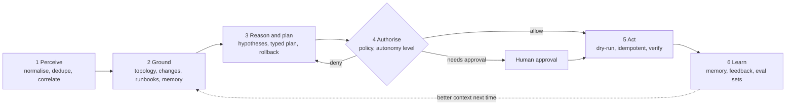

# The operating loop

Every agent, whatever its domain, runs the same six stages. Uniformity is what lets one policy engine, one telemetry schema and one evaluation harness cover every agent. It is the reason-and-act pattern from ReAct, hardened for production.

| Stage | Inputs | Output | Must emit |
| --- | --- | --- | --- |
| Perceive | Alert, ticket, chat, event | Canonical event (CloudEvents), correlation to open incidents | `agent.event.received`, correlation ratio |
| Ground | Event + entitlements of the requester | Context bundle: topology, recent changes, runbooks, similar incidents, live metrics | Retrieval latency, hit rate, ACL-filtered count |
| Reason and plan | Context bundle | Ranked hypotheses; typed plan where each step has an expected effect and a rollback | Model, tokens, router tier, plan confidence |
| Authorise | Each plan step | Allow, deny or require approval, with the rule that decided | Policy rule ID, decision, risk score |
| Act | Authorised step | Side effect via a tool, verified against post-conditions | Tool, idempotency key, dry-run result, status |
| Learn | Outcome | Episodic memory, feedback, new evaluation cases | Outcome, MTTR, feedback score |

## Worked example

A latency SLO burn alert fires on a checkout service. The triage SLM classifies it P2 and opens an incident. The supervisor delegates to the incident agent. The agent finds a deploy 40 minutes earlier and saturated pods, plans a scale from 6 to 10 replicas with a rollback, policy allows it at L4, the tool dry-runs then applies, and the agent watches p95 latency recover before resolving the ticket with an RCA. Each step is a span under the trace ID created when the alert fired.

---

[← Principles](01-principles.md) · [Index](README.md) · [Earned autonomy →](03-earned-autonomy.md)
