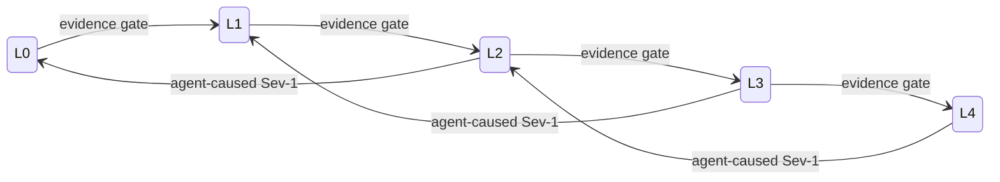

# Earned autonomy

Autonomy is set **per action type**, not per agent. The same incident agent may restart a pod on its own while still needing a human to approve a database failover.

| Level | Name | Agent does | Human does |
| --- | --- | --- | --- |
| L0 | Observe | Records what it would have done (shadow mode) | Everything |
| L1 | Recommend | Diagnoses and proposes a plan | Executes |
| L2 | Approve | Executes after approval | Approves or rejects each action |
| L3 | Notify | Executes, then notifies | Can roll back within a window |
| L4 | Autonomous | Executes and closes | Reviews samples and evaluation scores |

The levels borrow the spirit of SAE J3016 for driving automation and the user-role framing in Feng, McDonald and Zhang (2025).

## Promotion and demotion

**Evidence gate** — an action type moves up one level only when all of these hold at its current level:

- at least 200 executions, or 30 days, whichever comes later
- plan precision of 98% or better
- zero severity-1 side effects
- a rollback that has been exercised, not just written
- sign-off from the owning service team

**Automatic demotion** — any severity-1 incident caused by an agent drops that action type two levels immediately, through the kill switch, without waiting for a review.

Use the [promotion checklist](../templates/autonomy-promotion-checklist.md) to record each decision.

## Why this works with risk teams

It replaces the unanswerable question "do you trust AI?" with an answerable one: "here is the evidence for this single action." Each promotion is small, reversible and documented.

---

[← The operating loop](02-operating-loop.md) · [Index](README.md) · [The security gate model →](04-security-gate-model.md)
