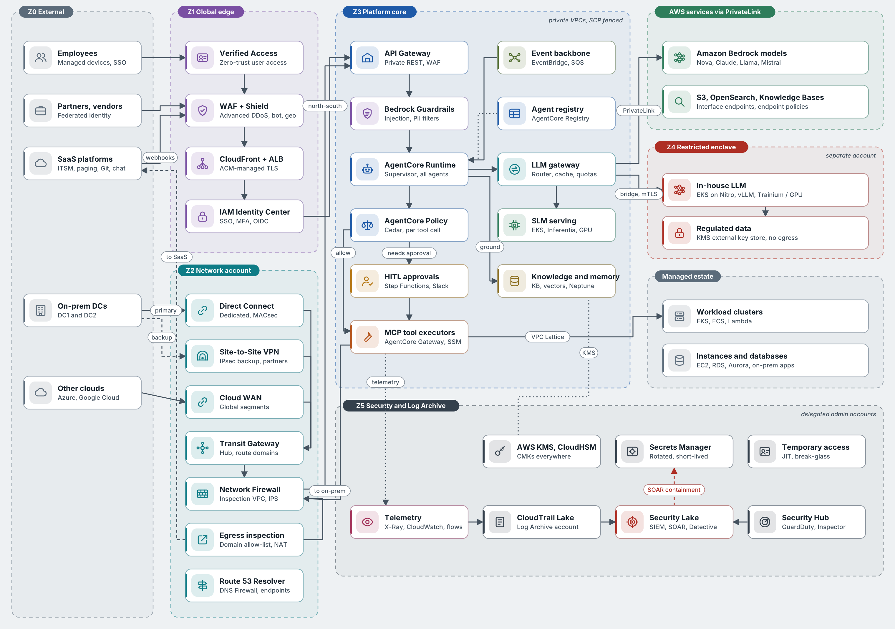
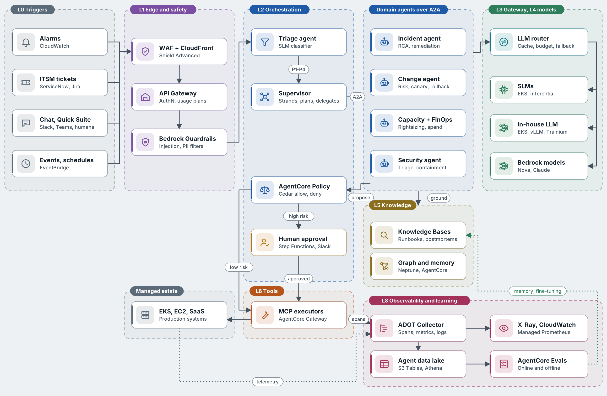
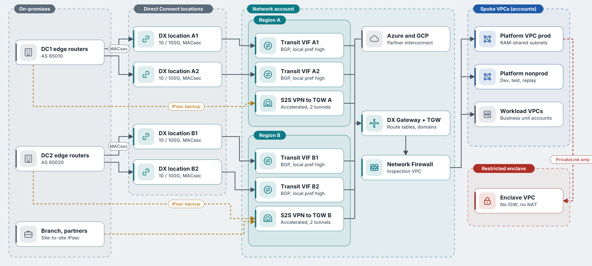

# Diagrams

Five icon diagrams per cloud, drawn with a consistent, original icon set and colour-coded by architecture layer.

| Folder | Contents |
| --- | --- |
| [`specs/`](specs/) | **Source of truth.** One JSON spec per diagram; edit these, never the SVGs |
| `svg/` | Static light-palette SVG for docs and Confluence |
| `png/` | 2× PNG for slides and articles |
| `themed/` | SVG using CSS custom properties, used by the explorer and portals for light and dark themes |

Rebuild everything with `./scripts/build-diagrams.sh`. The spec format and style rules are in the [`architecture-diagrams` skill](../skills/architecture-diagrams/SKILL.md).

| Diagram | Google Cloud | AWS |
| --- | --- | --- |
| Full system architecture across trust zones |  |  |
| End-to-end agentic flow |  |  |
| Hybrid connectivity |  |  |
| Runtime security gates G1–G12 |  |  |
| Telemetry pipeline |  |  |

## Colour key

| Colour | Layer |
| --- | --- |
| Slate | L0 channels and external systems |
| Purple | L1 edge, identity and content safety |
| Blue | L2 agent orchestration |
| Teal | L3 gateway and network transit |
| Green | L4 model serving |
| Ochre | L5 knowledge and memory |
| Orange | L6 tools and actions |
| Olive | L7 data and events |
| Magenta | L8 observability |
| Charcoal | L9 security and governance |
| Red | Restricted enclave, deny paths, security operations |
| Amber | Human approval and backup paths |

The icons are original drawings, not the official Google Cloud or AWS architecture icons. If you need official icons for formal reviews, both vendors publish icon sets for architecture diagrams.

Sequence diagrams and smaller flows are written in Mermaid inside the chapters under `architecture/`.
