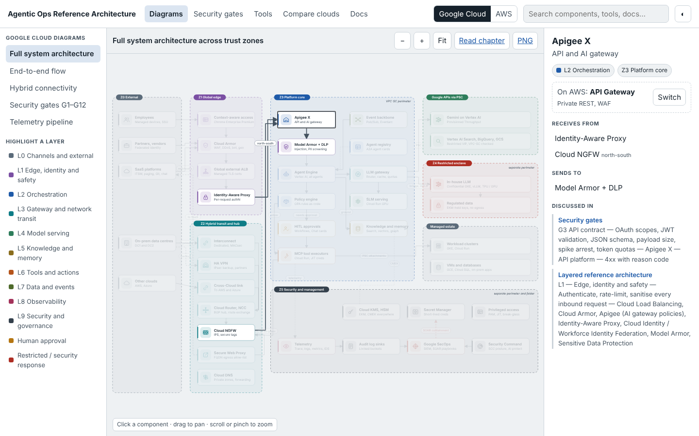

# Architecture Explorer

An interactive browser for this reference architecture, packaged as a framework-free web component: `<agentic-ops-explorer>`. Host it as a website, drop it into an existing architecture portal, or embed it in a wiki page.



## What it does

| View | What you can do |
| --- | --- |
| **Diagrams** | Pan and zoom the five icon diagrams per cloud. Click any component to see what it receives from and sends to, its layer and zone, the tools that act on it, the chapters that discuss it, and its equivalent on the other cloud (one click to switch). Highlight a whole layer. |
| **Security gates** | Step through G1–G12 with the checks, services, owner and failure behaviour on Google Cloud and AWS side by side, then jump to the gate on the diagram. Delivery gates D1–D8 below. |
| **Tools** | Filter the 31-tool MCP catalogue by category, server or mutating; see inputs, autonomy range, gates and the service each tool calls on each cloud. |
| **Compare clouds** | Both editions side by side; click a component on one side to highlight its counterpart. Filterable service-mapping table. |
| **Docs** | Every chapter, concept, ADR and the article, with diagrams embedded live and Mermaid sequence diagrams drawn when Mermaid can load. |

Global search covers components, tools, gates and every page. With `routing="hash"`, every state has a shareable link, for example `#/diagrams/aws/security-gates/g9-action-policy`.

## Files

| Path | Purpose |
| --- | --- |
| `src/agentic-ops-explorer.js` | The component source (about 45 KB, no dependencies) |
| `src/index.html` | Standalone page template |
| `build.py` | Builds `dist/data.json` from the repo: diagram specs, tool catalogue and Markdown |
| `dist/` | Ready-to-host output: `index.html`, `agentic-ops-explorer.js`, `data.json` |

Rebuild after changing any diagram spec, chapter or the tool catalogue:

```bash
pip install markdown pyyaml
python3 tools/build_catalog.py
python3 explorer/build.py   # defaults to the AgenticForze/AI-Regenesis repository, folder agentic-ops/
# optional single self-contained page:
python3 explorer/build.py --single-file explorer/dist/explorer-standalone.html
```

To refresh the live site, run `scripts/publish-site.sh`; it rebuilds everything and copies the explorer into `../docs/agentic-ops/explorer/`, which GitHub Pages serves at <https://agenticforze.github.io/AI-Regenesis/agentic-ops/explorer/>.

## Embedding

See [EMBEDDING.md](EMBEDDING.md) for portal integration: script tag, iframe, single file, theming, events, deep links and Content Security Policy.
