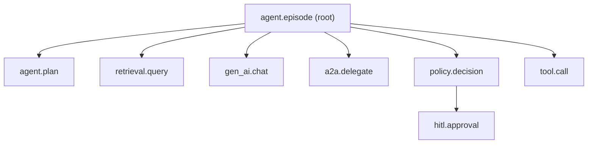

# OpenTelemetry span schema for agents

Use the OpenTelemetry GenAI semantic conventions (`gen_ai.*`) for model calls and this `agent.*` namespace for everything else. Every span in an episode shares one trace ID created when the triggering signal arrived.

| Span | Required attributes | Notes |
| --- | --- | --- |
| `agent.episode` | `agent.id`, `agent.version`, `trigger.type`, `incident.id`, `autonomy.level`, `outcome`, `cost.total_usd` | Root span. Outcome is one of `resolved`, `escalated`, `failed`, `rolled_back`. |
| `agent.plan` | `plan.steps`, `plan.hypotheses`, `plan.confidence` | One per planning round. |
| `gen_ai.chat` | `gen_ai.request.model`, `gen_ai.usage.input_tokens`, `gen_ai.usage.output_tokens`, `router.tier`, `cache.hit`, `ttft_ms` | Follow the GenAI semantic conventions; add router attributes. |
| `retrieval.query` | `retrieval.index`, `retrieval.top_k`, `retrieval.docs_returned`, `retrieval.acl_filtered` | Never record document contents. |
| `policy.decision` | `policy.rule_id`, `policy.decision`, `policy.mode`, `risk.score`, `blast_radius` | `mode` is `enforce` or `log_only` (shadow). |
| `hitl.approval` | `approver.id`, `approval.wait_ms`, `approval.decision` | Approver identity, never free-text comments with PII. |
| `tool.call` | `tool.name`, `tool.server`, `tool.idempotency_key`, `tool.dry_run`, `tool.status`, `side_effect.id` | `side_effect.id` links to the ledger. |
| `a2a.delegate` | `a2a.from_agent`, `a2a.to_agent`, `a2a.task_id` | |

## Sampling and privacy

- Tail-sample: keep 100% of episodes with errors, approvals, rollbacks or cost above the 95th percentile; sample the rest.
- Redact PII from prompts and completions in the collector before export.
- Store full prompts only in the restricted analytical store, with retention set by data class.
